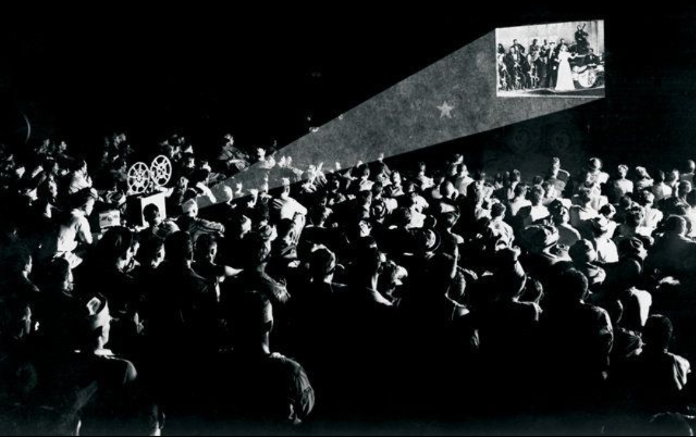

# KinepoliCS

Web platform for the KinepoliCS student cinema association. Centralizes movie suggestions, screening reviews, and concession stand orders.

Visit the website [here](https://kinepolics.pages.dev/) and check the API service [here](https://kinepolics.onrender.com/).




## Architecture

Decoupled frontend-backend architecture running on cloud infrastructure:

* **Frontend:** Vanilla JavaScript (ES6+), HTML5, CSS3 served via Cloudflare Pages CDN.
* **Backend:** Python standard library (`http.server`) web service deployed on Render.
* **Database:** SQLite 3 (`cinema.db`).
* **Integrations:** TMDB (The Movie Database) API for real-time movie search.


## Key Features

1. **LetterboCS**  
View past screening history, aggregate ratings, and audience feedback word clouds.
2. **Movie Suggestions**  
Search TMDB in real time and submit film ideas for upcoming screenings.
3. **Popcorn**  
Select popcorn sizes and flavors (Sucré / Salé), manage cart items, and place orders.


## Repository Structure

```text
student-cinema/
├── server.py         # Application backend, HTTP server, database & REST API
├── database.py       # Backwards-compatible re-export module (from server import get_db, init_db)
├── test_app.py       # Automated API test suite
├── requirements.txt  # Environment config for Render deployment (standard library)
├── cinema.db         # SQLite database
├── index.html        # Single-page application markup
├── style.css         # Theme stylesheet
├── app.js            # Client-side state and API request handling
├── fonts/            # Custom vintage cinema typography
└── visuals/          # Posters, logos, and illustrations
```
